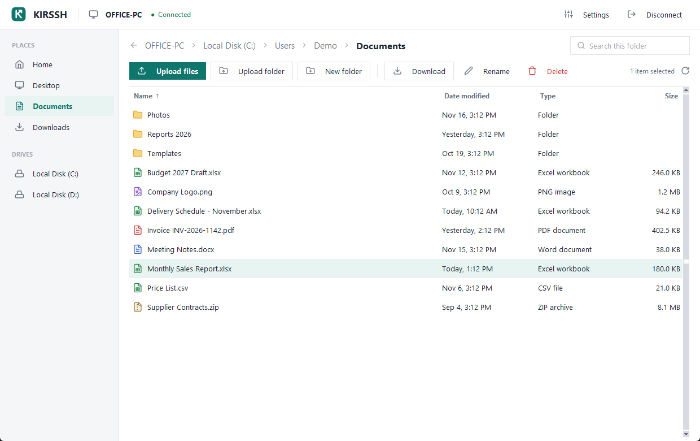
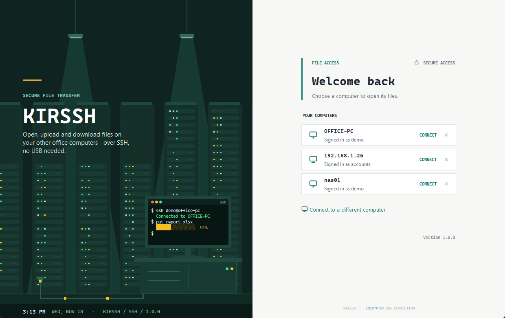
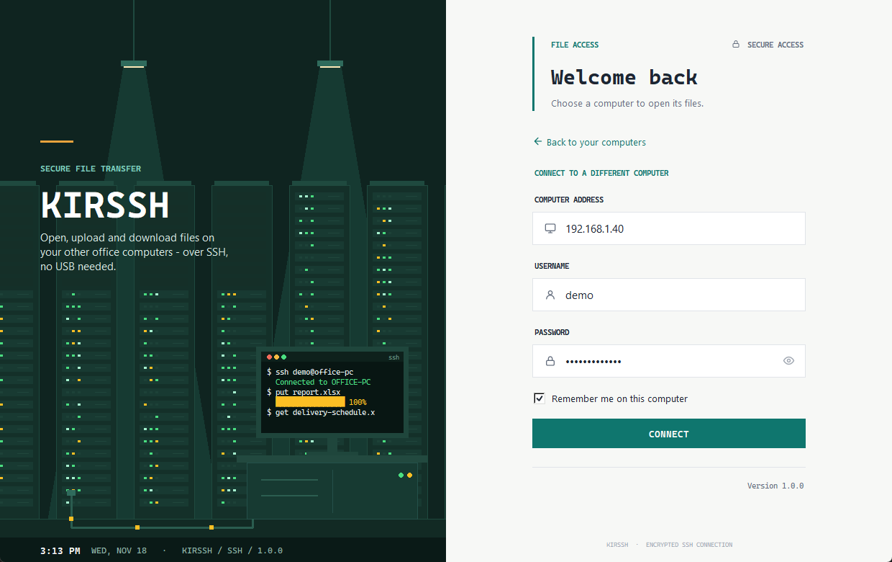
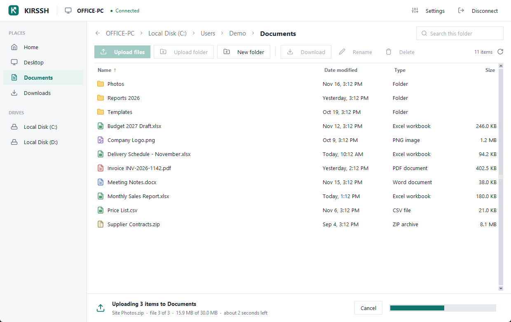
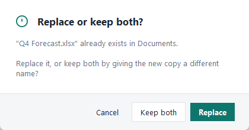
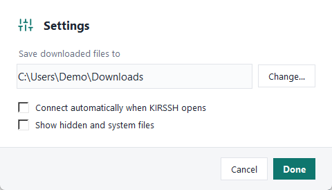

# KIRSSH

Open, upload and download files on your other office computers, over SSH or Windows file sharing. No USB drive needed.



## Features

- **One-click sign-in.** Saved computers connect again with a single click, and can reconnect automatically when KIRSSH opens.
- **Familiar file browser.** Folders, breadcrumbs, search, sorting, drives and the usual places (Desktop, Documents, Downloads).
- **Upload and download.** Files and whole folders, with progress, time remaining and Cancel. You can drag files in from File Explorer.
- **Open and edit in place.** Double-click a file to open it in its usual program. When you save, KIRSSH sends it back to the other computer.
- **Two ways to connect.** SSH (SFTP) or Windows shared folders (`\\server\share`). KIRSSH picks the one that works.
- **Safe by default.** Passwords are encrypted with your Windows account, and each computer's identity is checked every time you connect.

## Screenshots

| Sign in | Connect to a new computer |
| --- | --- |
|  |  |

| Uploading | Replace or keep both |
| --- | --- |
|  |  |



## Getting started

### Option 1: Run the app

Open `dist\KIRSSH.exe`. Nothing else needs to be installed.

### Option 2: Run from source

Requires **Python 3.15** on Windows. KIRSSH needs Tk 9, which comes with Python 3.15; older versions can't draw its icons and won't start.

```bash
py -3.15 -m pip install -r requirements.txt
```

Then double-click `KIRSSH.bat`, or run:

```bash
py -3.15 kirssh.py
```

### The other computer

The computer you connect to needs one of:

- **OpenSSH Server.** On Windows: *Settings → System → Optional features → OpenSSH Server*, then start the *OpenSSH SSH Server* service.
- **Windows file sharing.** A shared folder, or a NAS.

## Using KIRSSH

### Connecting

Type the address the same way you would in File Explorer:

| You type | KIRSSH opens |
| --- | --- |
| `192.168.1.40` or `OFFICE-PC` | The computer's home folder |
| `\\OFFICE-PC\Users\Demo\Documents` | That folder (`C:\Users\Demo\Documents`) |
| `\\OFFICE-PC\D$\Shared` | `D:\Shared` |
| `\\nas01` | The NAS's list of shared folders |
| `demo@192.168.1.40:2222` | SSH on port 2222, as user `demo` |

The username and password are optional for shared folders: without them, KIRSSH uses your own Windows login. Tick **Remember me** to save the password for next time.

### Working with files

| Action | How |
| --- | --- |
| Open a folder or file | Double-click, or press **Enter** |
| Go up / back | **Backspace** / **Alt + Left** |
| Upload | **Upload files**, **Upload folder**, or drag files onto the list |
| Download | Select items, then **Download** (saved to your Downloads folder, or the folder chosen in **Settings**) |
| Rename / delete | **F2** / **Delete**, or right-click |
| Refresh | **F5** |
| Type a path | Click the breadcrumb bar |

If a file with the same name already exists, KIRSSH asks whether to **Replace** it or **Keep both**.

### Editing files on the other computer

Double-click a document to open it in Word, Excel or any other program. Each time you save, KIRSSH copies it back to the other computer. If someone else changed the file after you opened it, KIRSSH asks before saving: **Save mine as a copy**, **Replace theirs**, or **Not now**.

## Security

- **Passwords** are encrypted with Windows DPAPI, so only your Windows account on this PC can read them.
- **Computer identity.** The first time you connect over SSH, KIRSSH remembers the computer's identity. If a different machine answers at that address later, KIRSSH stops before sending your password and shows a warning. Only choose **Trust the new identity** if you know the computer was reinstalled or replaced.
- **Safe transfers.** Files are copied to a temporary name first and only replace the original once complete, so a cancelled or failed transfer never destroys the existing file.

Settings and saved computers are stored in `%APPDATA%\KIRSSH`. Settings from older versions, stored in `%APPDATA%\KIRSHH`, are copied over automatically.

## Building the app

```bash
py -3.15 -m pip install -r requirements.txt pyinstaller
```

```bash
py -3.15 -m PyInstaller --noconfirm --clean --distpath dist build_assets/KIRSSH.spec
```

The app is created at `dist\KIRSSH.exe`.

## Tests

```bash
py -3.15 tests/test_fixes.py .
```

The tests run a small SFTP server on your own computer and check transfers, saving edits back and identity checks. They use a temporary folder and never touch your real settings.

## Project layout

| Path | Contents |
| --- | --- |
| `kirssh.py` | The whole app |
| `KIRSSH.bat` | Starts the app from source |
| `requirements.txt` | Python packages needed |
| `build_assets/` | App build settings, icon and version info |
| `tests/` | Automated tests |
| `docs/screenshots/` | Images used in this README |
